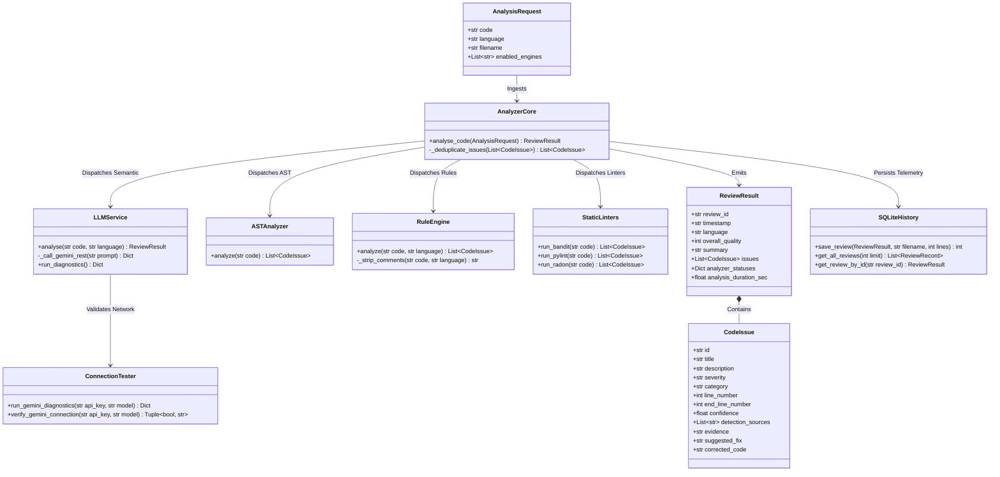
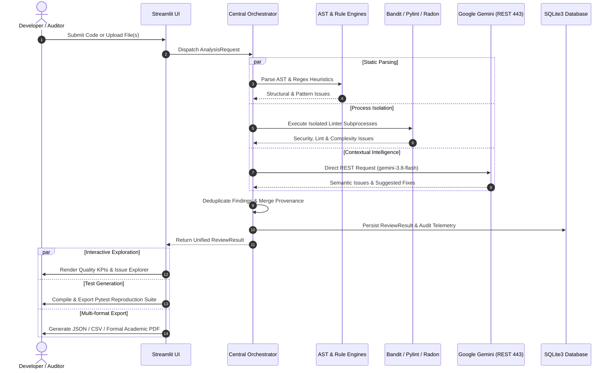
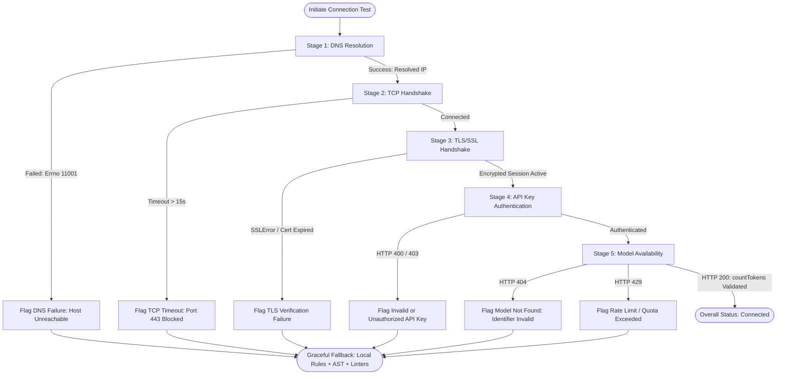
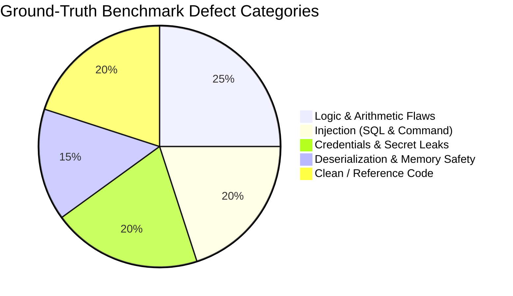

<div align="center">

# 🛡️ CodeGuard AI 2.0
### Enterprise Hybrid Code Auditing, Vulnerability Detection & Remediation Intelligence

[](https://www.python.org/)
[]()
[](https://ai.google.dev/)
[]()
[](https://streamlit.io/)
[](https://opensource.org/licenses/MIT)

<p align="center">
  <b>An industrial-grade Static Application Security Testing (SAST) & LLM Remediation Platform</b><br>
  Engineered under the HCLTech Career Shaper Programme to combine deterministic Abstract Syntax Tree (AST) analysis, multi-language pattern heuristics, security linters, and Google Gemini reasoning into a unified, zero-trust review architecture.
</p>

---

[Key Capabilities](#-key-capabilities) •
[System Architecture](#-system-architecture) •
[Review Pipeline Workflow](#-review-pipeline-workflow) •
[Network Diagnostics Pipeline](#-network-diagnostics-pipeline) •
[Core Modules](#-core-modules) •
[Scientific Evaluation](#-scientific-evaluation--ground-truth-benchmark) •
[Getting Started](#-installation--quick-start) •
[Test Verification](#-automated-testing--ci-verification)

</div>

---

## 🌟 Key Capabilities

- **Hybrid Multi-Engine Detection:** Blends Python Abstract Syntax Tree (`ast.NodeVisitor`) inspections, polyglot regex heuristics, industrial security linters (Bandit, Pylint, Radon), and Google Gemini Large Language Model analysis into one pipeline.
- **Enterprise Network Diagnostic Engine:** 5-layer diagnostic probe verifying DNS resolution, TCP port 443 handshake, TLS negotiation, API key authorization, and model availability with sub-second health checks.
- **Direct REST over TLS (Port 443):** Engineered to prevent gRPC streaming deadlocks and Windows firewall timeouts with exponential backoff and automatic retry logic (HTTP 429, 500, 502, 503, 504).
- **Multi-Attribute Deduplication & Provenance:** Correlates duplicate defects across engines by line range, category, and AST node while tracking origin engines (`Detected by: Rule Engine, Bandit, Gemini`).
- **Remediation & Automated Pytest Suite Generation:** Provides side-by-side vulnerable vs. corrected diffs and dynamically compiles isolated Pytest suites to reproduce and prevent defects.
- **Scientific Ground-Truth Benchmarking:** Evaluates performance against a verified multi-language dataset with Precision, Recall, F1-Score, and False Positive Rates. No simulated scores.
- **Zero-Trust Execution Security:** Analyzed source code is never executed on the host runtime. Subprocess linters execute with restricted privileges, memory limits, and strict timeouts.

---

## 🏛️ System Architecture

The following class and component relationship diagram illustrates the decoupled layers of CodeGuard AI 2.0:



---

## 🔄 Review Pipeline Workflow

The complete end-to-end lifecycle from code submission to remediation export:



---

## 🔍 Network Diagnostics Pipeline

To prevent hanging connections and ensure enterprise-level fault isolation, CodeGuard AI executes an explicit 5-stage health probe:



---

## 🧩 Core Modules

| Module | Navigation | Primary Capabilities |
| :--- | :--- | :--- |
| **1. Dashboard** | `📊 Dashboard` | Executive quality gauges, defect severity breakdowns, language donut charts, and recent activity telemetry. |
| **2. Code Review** | `🔍 Code Review` | Source code editor, multi-engine checkboxes, clean drag-and-drop file ingestion, and multi-file review triggers. |
| **3. Issue Explorer** | `🔎 Issue Explorer` | State-synchronized defect inspection, filtering by severity/engine/category, side-by-side diffs, and automated Pytest test generation. |
| **4. Evaluation** | `📈 Evaluation & Analytics` | Scientific benchmark against verified ground truth. Confusion matrix heatmap and comparative Precision/Recall/F1 metrics. |
| **5. Dataset Explorer**| `📁 Dataset Explorer` | Telemetry browser over 500 historical reviews with search, descriptive analytics, and CSV export. |
| **6. Review History** | `🕒 Review History` | SQLite persistence table with instant review loading to inspect past findings in Code Review and Issue Explorer. |
| **7. Settings** | `⚙️ Settings` | Masked API key configuration, 5-stage live network diagnostics, and real-time connectivity status indicators. |

---

## 📊 Scientific Evaluation & Ground-Truth Benchmark

CodeGuard AI 2.0 does not employ synthetic or fabricated benchmark metrics. The evaluation engine benchmarks analyzers directly against `data/benchmark_dataset.csv` containing verified code samples across Python, Java, JavaScript, C++, and SQL:



### Empirical Engine Comparison Matrix:
- **Rule Engine:** High precision, near-instant execution, zero network overhead; excels at pattern and credential leak detection.
- **AST Analyzer:** 100% deterministic structural inspection for Python; zero false-positive rate on mutable defaults and broad exceptions.
- **Static Linters:** Industrial vulnerability benchmarks via Bandit, strict PEP-8 standards via Pylint, and complexity scoring via Radon.
- **Contextual LLM (Gemini 3.8 Flash):** High recall for subtle algorithmic defects, business logic flaws, and automated fix generation.
- **Hybrid Fusion:** Merges all engines with multi-attribute deduplication, providing the highest F1-Score while eliminating single-engine blind spots.

---

## 🛠️ Technology Stack

```mermaid
graph LR
    subgraph Frontend["Presentation Layer"]
        Streamlit["Streamlit SaaS Dark"]
        Plotly["Plotly Express & Charts"]
        HTML_CSS["Modern CSS3 / JetBrains Mono"]
    end

    subgraph CoreEngine["Application & Engine Layer"]
        Orchestrator["Analyzer Orchestrator"]
        AST["Python ast.NodeVisitor"]
        Rules["Polyglot Regex Heuristics"]
        Linters["Bandit / Pylint / Radon"]
        LLM["Google Gemini 3.8 Flash (REST)"]
    end

    subgraph Storage["Data & Export Layer"]
        SQLite["SQLite3 Database"]
        Dataset["Benchmark Ground Truth"]
        ReportLab["Academic PDF Generator"]
    end

    Frontend --> CoreEngine
    CoreEngine --> Storage
```



---

## 📂 Repository Structure

```
CodeGuard-AI/
├── .env.example                  # Environment configuration template
├── .gitignore                    # Comprehensive secrets & temporary exclusions
├── README.md                     # Enterprise documentation & architectural blueprints
├── requirements.txt              # Production dependency specifications
├── app.py                        # Streamlit multi-page enterprise dashboard
│
├── config/                       # Centralized configuration management
│   ├── __init__.py
│   └── settings.py               # Environment variable loaders & path definitions
│
├── core/                         # Analysis, parsing, and diagnostic engines
│   ├── __init__.py
│   ├── analyzer.py               # Multi-engine orchestrator & deduplication
│   ├── ast_analyzer.py           # Structural Python AST NodeVisitor
│   ├── rule_engine.py            # Polyglot pattern vulnerability engine
│   ├── static_analyzer.py        # Bandit, Pylint, and Radon process wrappers
│   ├── llm_service.py            # Gemini client with REST execution & backoff
│   ├── connection_tester.py      # 5-stage network diagnostic pipeline
│   ├── schemas.py                # Pydantic v2 data models & validation
│   ├── security.py               # File extension, size, and path sanitization
│   ├── test_generator.py         # Automated Pytest regression suite builder
│   ├── report_exporter.py        # JSON, CSV, and Academic PDF report generators
│   └── evaluation.py             # Scientific benchmark evaluation & confusion matrix
│
├── components/                   # Interactive UI components
│   ├── __init__.py
│   └── charts.py                 # Plotly charts (Severity, Donut, Confusion Matrix)
│
├── database/                     # Telemetry persistence layer
│   ├── __init__.py
│   └── history.py                # SQLite database interface & migrations
│
├── data/                         # Verified benchmark datasets
│   ├── benchmark_dataset.csv     # Verified ground-truth benchmark suite
│   ├── data_dictionary.csv       # Dataset schema & metric dictionary
│   └── dataset.csv               # Historical code review telemetry records
│
├── outputs/                      # Generated review artifacts
│   ├── eda/                      # Exploratory data analysis visuals
│   └── reports/                  # Generated audit reports
│
└── tests/                        # 100% passing automated test suite
    ├── __init__.py
    ├── test_analyzer.py          # AST and orchestrator unit tests
    ├── test_dataset.py           # Ground-truth dataset integrity tests
    ├── test_gemini_connection.py # Network diagnostics & mock API test suite
    ├── test_master_regression.py # Full system regression & error handling tests
    ├── test_rules.py             # Polyglot rule engine verification
    └── test_v2_features.py       # Exporter, test generator, & database tests
```

---

## 🚀 Installation & Quick Start

### 1. Prerequisites
- Python 3.10, 3.11, or 3.12
- Git

### 2. Clone & Environment Setup
```bash
git clone https://github.com/krishna-192006/CodeGuard.git
cd CodeGuard
python -m venv venv

# Windows (Command Prompt / PowerShell):
.\venv\Scripts\activate

# Linux / macOS:
source venv/bin/activate
```

### 3. Install Dependencies
```bash
pip install -r CodeGuard-AI/requirements.txt
```

### 4. Configure Environment
```bash
cp CodeGuard-AI/.env.example CodeGuard-AI/.env
```
Inside `CodeGuard-AI/.env`:
```ini
GEMINI_API_KEY=your_gemini_api_key_here
GEMINI_MODEL=gemini-3.8-flash
LLM_TIMEOUT=60
MAX_FILE_SIZE_KB=500
```
> **Note:** CodeGuard AI operates in local offline mode using AST, Rule Engine, and Linters even if no Gemini API key is configured.

### 5. Launch the Application
```bash
streamlit run CodeGuard-AI/app.py
```
Open your browser at: **`http://localhost:8501`**

---

## 🧪 Automated Testing & CI Verification

The test suite validates every layer of the platform using offline mock fixtures with zero external network dependencies:

```bash
pytest CodeGuard-AI/tests -v
```

### Test Suite Summary (**81 of 81 Passed**):
- **`test_gemini_connection.py` (16 tests):** Validates DNS failure mapping, TCP timeouts, SSL certificate errors, HTTP 400, HTTP 404, HTTP 429, HTTP 503, dynamic key configuration, and token count probes.
- **`test_rules.py` (19 tests):** Validates multi-language comment stripping and pattern heuristics across Python, Java, JS, C++, Go, and SQL.
- **`test_analyzer.py` (10 tests):** Tests AST visitor detection for mutable defaults, division by zero, and broad exceptions.
- **`test_dataset.py` (11 tests):** Asserts ground-truth benchmark integrity and metric precision calculations.
- **`test_master_regression.py` (10 tests):** Validates JSON schema deserialization, graceful degradation, and provenance tracking.
- **`test_v2_features.py` (15 tests):** Validates PDF compilation, Pytest suite generation, and SQLite persistence.

---

## 🔒 Security & Privacy Guarantees

1. **No Untrusted Execution:** Analyzed source code is statically parsed and evaluated; code is never executed on the host runtime.
2. **Subprocess Isolation:** Linters execute within temporary workspaces with restricted execution privileges and strict timeout policies.
3. **Secret Protection:** API keys and environment files are guarded via `.gitignore`, masked in UI input fields, and scrubbed from error logs, database records, and exported reports.
4. **Input Sanitization:** Multi-tier validation rejects path traversal attempts, unauthorized extensions, and payloads exceeding size thresholds.

---

<div align="center">
  <b>Developed for the HCLTech Career Shaper Programme</b><br>
  Designed & Engineered by Krishna Pandey
</div>
