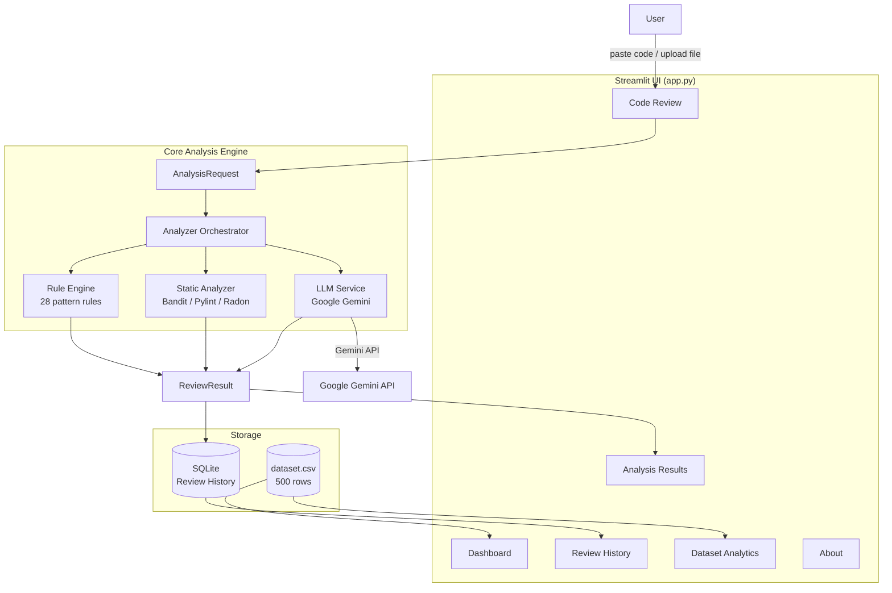
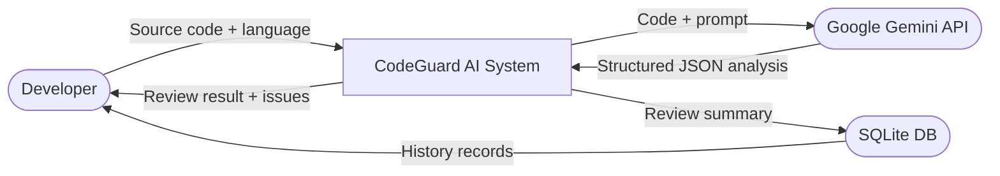

# System Architecture — CodeGuard AI

## Overview

CodeGuard AI is a Streamlit-based web application with a modular Python architecture. It integrates three analysis layers — rule-based pattern matching, static analysis tools, and LLM reasoning — to produce structured code review reports.

---

## System Block Diagram



---

## Level 0 Data Flow Diagram



---

## Component Descriptions

### `app.py`
Main Streamlit entry point. Handles navigation, UI rendering, session state, and orchestrates calls to all modules.

### `config/settings.py`
Reads all configuration from environment variables. Provides typed constants (model name, paths, timeouts).

### `core/schemas.py`
Pydantic v2 data models:
- `AnalysisRequest` — input from the user
- `CodeIssue` — a single detected problem
- `ReviewResult` — full analysis output
- `ReviewRecord` — history record

### `core/rule_engine.py`
Applies compiled regex patterns to source code line-by-line. 16 Python rules + 12 Java rules. Never makes network calls.

### `core/static_analyzer.py`
Wraps Bandit (security), Pylint (quality), and Radon (complexity) by writing code to a temporary file and capturing JSON output. Degrades gracefully if tools are not installed.

### `core/llm_service.py`
Calls the Google Gemini API using the official SDK. Validates the JSON response via Pydantic. Handles rate limits, timeouts, and JSON parse errors.

### `core/analyzer.py`
Orchestrates the three analysis layers. When LLM is available, results are merged (hybrid mode). When unavailable, rule-based + static analysis is used.

### `core/security.py`
Input validation: file extension whitelist, file size limit, display sanitisation, credential masking for logs.

### `database/history.py`
SQLite persistence for review summaries. Creates the database and schema on first run. The application works without a database if SQLite is unavailable.

### `components/charts.py`
Plotly chart factory functions used on both Dashboard and Dataset Analytics pages.

---

## Data Flow: Code Analysis Request

```
1. User pastes code → Code Review page
2. AnalysisRequest created (code, language, filename)
3. Orchestrator dispatches to:
   a. RuleEngine.analyse_python|java() → [CodeIssue]
   b. StaticAnalyzer.analyse_python|java() → [CodeIssue]
   c. LLMService.analyse() → ReviewResult (if API key set)
4. Results merged into final ReviewResult
5. ReviewResult stored in SQLite via history.save_review()
6. User navigates to Analysis Results page
7. Issues displayed with severity filters and fix comparisons
```

---

## Security Architecture

| Concern | Mitigation |
|---|---|
| Code execution | Uploaded code is never executed |
| API key exposure | Read from env vars; never logged |
| Malicious uploads | Extension whitelist + size limit |
| Automatic fix application | All fixes require manual developer approval |
| LLM hallucinations | Results clearly labelled as suggestions |
